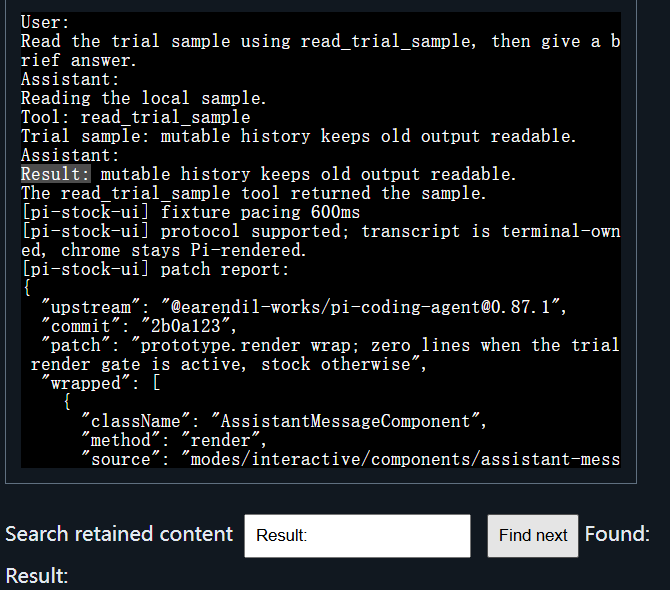

# Why this project exists

Status: project narrative, 2026-10-11. A five-minute read; every claim links
to its evidence.

## The gap: applications think in content, terminals think in rows

AI agents generate, revise, and finalize content throughout an ongoing
session. Applications manage that content as logical units with identity
and lifecycle, while the terminal protocol expresses character output and
screen operations. The gap is between the application's content model and
what it can communicate to the terminal — not between two redraw
strategies.

The concrete consequence: rows already committed to terminal-owned
scrollback have no application-addressable identity. An application that
must revise earlier output cannot name it, so it can only redraw — and
every available redraw strategy disturbs the reader.

## The paths already tried

**Differential redraw** rewrites only changed lines. It cannot reach
anonymous rows already in scrollback, so it cannot express revision of
historical content at all; when streamed output reflows above the viewport,
correctness forces a full redraw.

**Full redraw** clears and replays (`ESC[3J`). It reaches historical rows at
the cost of the reader's position and selection. A Pi user documented the
scroll-loss mechanism and the protocol-level constraint behind it in
[pi issue #7304](https://github.com/earendil-works/pi/issues/7304). Kimi
Code's attempt to contain the damage — anchoring differential patches to
buffer row indices while content shifted underneath — accumulated edge
cases faster than they could be stabilized, and ended in a full revert with
the symptom re-accepted
([PR #1367](prior-art.md#application-architecture-evidence)).

**Application-owned viewport** keeps a private transcript and reimplements
scrolling, selection, search, and copy inside the application. It delivers
good rewrap and copy fidelity, but feeling native across terminal
emulators, operating systems, input modalities, multiplexers, and fonts is
a combinatorial tail. OpenAI's Codex retired its TUI2 experiment after
deleting 82,802 lines
([PR #9640](prior-art.md#application-architecture-evidence)). Pi's
alternate-screen renderer, intended to become the default, is still
resolving full-transcript repaint costs
([issue #9549](prior-art.md#application-architecture-evidence)).

The configuration none of these provides: terminal-owned history that stays
correct when offscreen content changes, with the reader's position
preserved.

## The third path

Give content identity at the protocol layer. The application decides what
the content is and when it changes; the terminal decides how it looks,
where it sits, and keeps the user's reading position; a small protocol
carries semantic changes between them — append, update, extend, replace a
suffix, seal. The terminal never has to clear and replay; the application
never has to reimplement scrolling, selection, search, or copy. The formal
model is [RFC 0001](rfcs/0001-mutable-terminal-history-and-reading-anchors.md).

## What exists today

Three [milestones](../README.md#milestones) through 2026-10-03. The latest:
Pi 0.87.1's stock interactive UI — its unmodified editor, footer, and
status — running while the transcript above is owned by protocol Blocks,
verified by four automated browser scenarios through a real terminal path:
a full turn with editor input during streaming, cancellation and a further
turn, a resize round trip, and unsupported-terminal fallback
([Pi stock-UI trial](../prototypes/integration/pi-stock-ui/README.md)).

The repository holds 300+ Node tests, dated checkpoints, and bounded claims
throughout — including recorded failures, such as the two-writer conflict
that motivated the terminal host's
[region ownership](design/host-region-ownership.md).

## Honest status

This is a research prototype, not a standard. Content is plain text only;
the supporting terminal is one experimental host; the evidence is
Windows-only so far; live-model runs exist for the SDK frontend but not yet
for the stock-UI path. Two constraints shape what happens next: the
cold-start loop and one maintainer's bandwidth
([current constraints](../README.md#current-constraints)).

## Who might care, and what would help most

- **People who use agent TUIs every day.** This project exists for their
  reading experience: keeping your place, your selection, and your history
  while output streams. If that is you, this evidence is yours to cite when
  asking your terminal or agent of choice for a fix — user demand is what
  moves vendors.
- **Terminal emulator developers and TUI framework authors** who have hit
  the same wall. The single most useful contribution is a second
  terminal-side implementation, independent of this project's host code
  ([adoption path](design/adoption-path.md)).
- **Agent-application teams** choosing a rendering strategy. The three
  documented attempts above are the map of what has already been tried.

All evidence and design documents are public, and the
[protocol drafts](README.md) describe the semantics in full.
